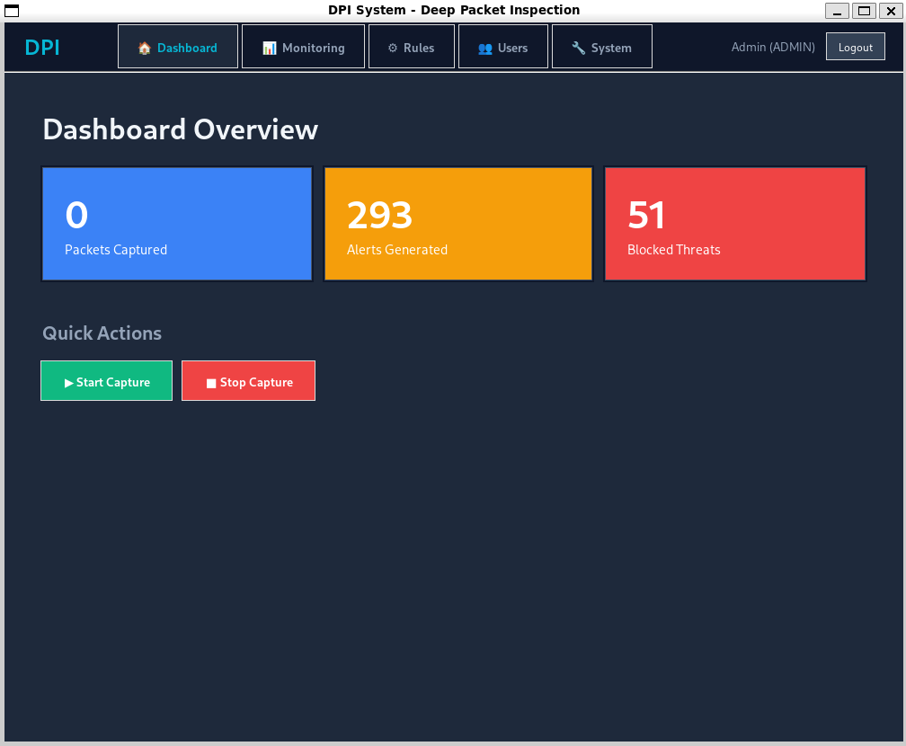
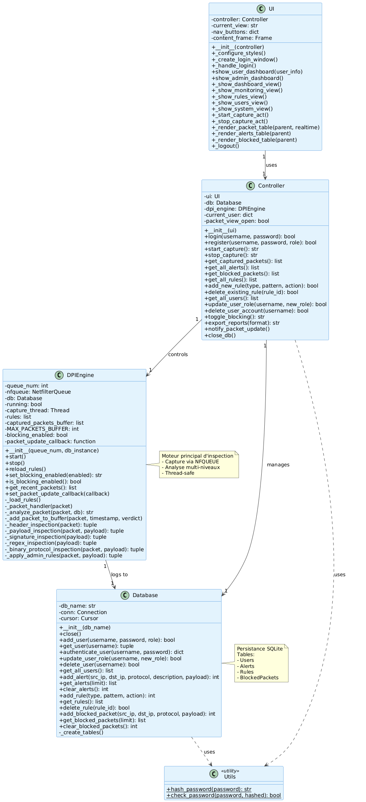
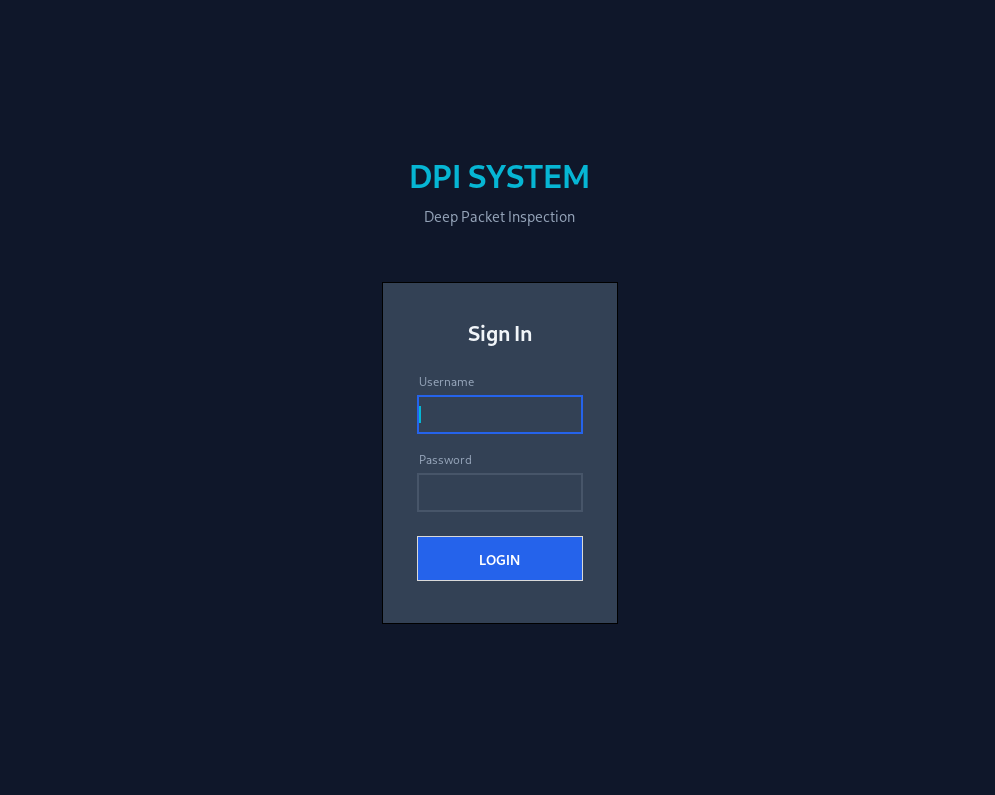
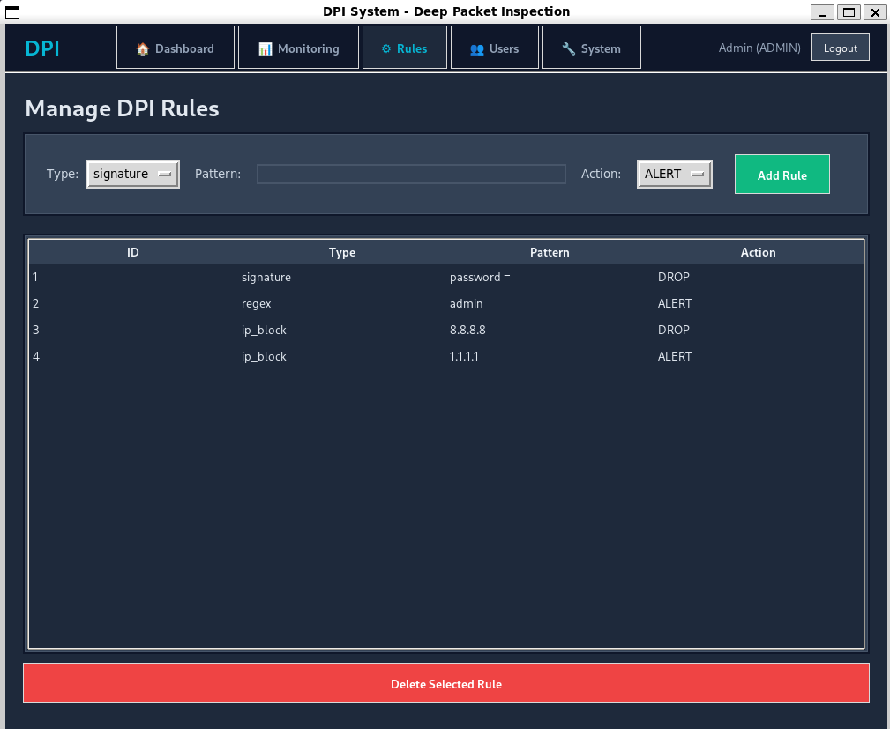
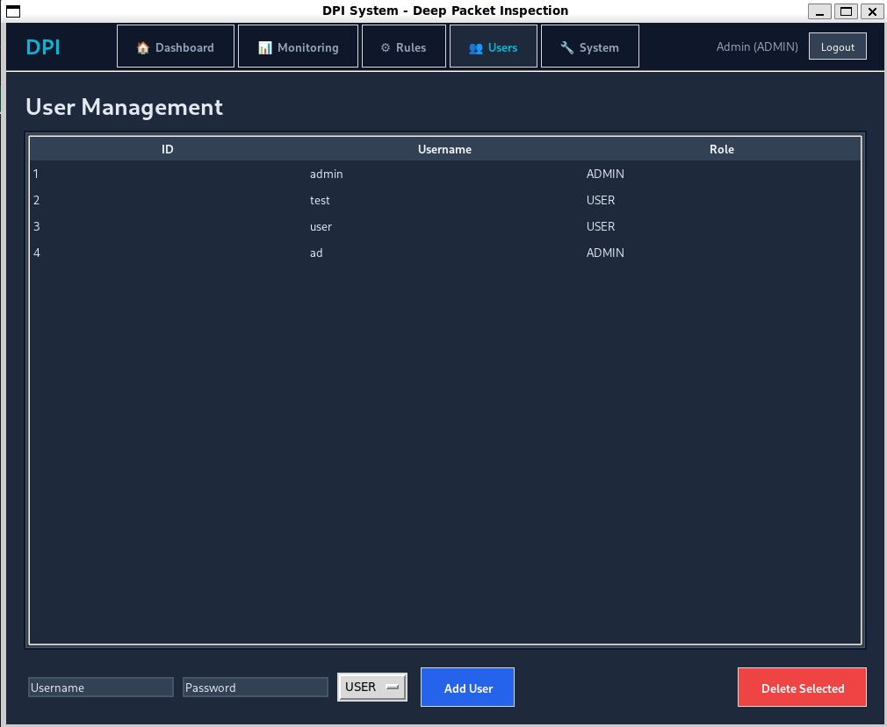
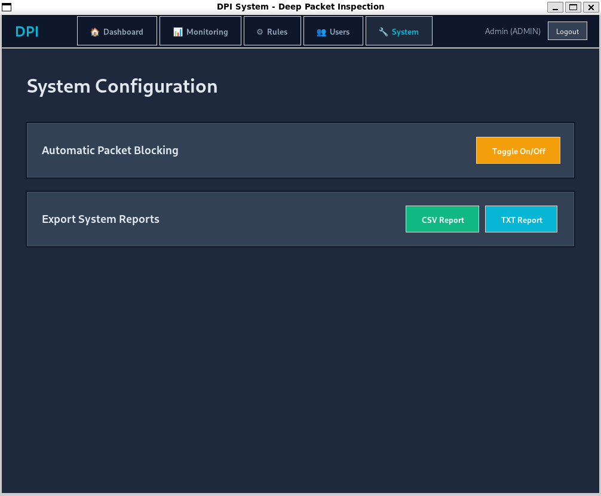

# DPI Network Traffic Inspector

**A Python deep packet inspection (DPI) system with a Tkinter GUI, role-based user management and automatic blocking of malicious traffic through NFQUEUE.**



## Overview

This mini-project intercepts live network traffic on Linux with `iptables` + `NFQUEUE`. Each packet is parsed with Scapy and passed through several inspection layers: header checks, signature matching, regular expressions, protocol fingerprinting, rate-based DDoS detection and admin-defined IP rules. The engine then accepts or drops the packet. Alerts and blocked packets are stored in SQLite and shown in a dark-themed desktop GUI. Separate views exist for regular users (monitoring) and administrators (rules, users, system settings).

It was developed and tested on **Windows 11 + WSL2 (Kali Linux)**, using WSLg for the GUI.

## Key features

- **Real-time packet interception.** NetfilterQueue binds to NFQUEUE 0. Every packet gets an ACCEPT or DROP verdict.
- **Multi-layer inspection** (`dpi/dpi_engine.py`):
  - Header inspection: detects fragmented IP packets.
  - Payload signature matching: case-insensitive byte patterns.
  - Regex matching on decoded payloads.
  - Protocol fingerprinting: HTTP, DNS, FTP, SMTP and SSH by port and payload markers, plus traffic on high or dynamic ports.
  - DDoS detection: a sliding-window packet-rate threshold per source IP (more than 15 packets in 5 s by default).
  - Admin rules: `ip_block` rules on source or destination IP.
- **Configurable rules.** Rules have a type, pattern and action (`ALERT` / `DROP`), are stored in SQLite and reload live when edited.
- **Automatic blocking toggle.** Blocking can be switched off so the system only raises alerts.
- **User management.** bcrypt-hashed passwords, with `USER` and `ADMIN` roles. Admins add and delete users from the GUI.
- **Logging and reporting.** Alerts and blocked packets are persisted to SQLite and can be exported as CSV (pandas) or TXT reports.
- **Traffic generators for testing.** Scapy scripts craft packets that trigger each rule type and simulate an ICMP flood.

## Tech stack

| Area | Technologies |
|---|---|
| Language | Python 3.10+ |
| Packet capture / crafting | Scapy, NetfilterQueue (`libnetfilter-queue`), iptables |
| GUI | Tkinter / ttk |
| Storage | SQLite (`sqlite3`) |
| Security | bcrypt |
| Reporting | pandas |
| Environment | Linux (tested on Kali under WSL2 with WSLg) |

## Architecture

The application follows an MVC-style split:

```
UI (Tkinter)  ──>  Controller  ──>  DPIEngine (NFQUEUE + Scapy)
                       │                  │
                       └──────>  Database (SQLite)  <──┘
                                     │
                                  Utils (bcrypt)
```



### Project structure

```
.
├── dpi/                       # Main application
│   ├── main.py                # Entry point: creates the initial admin, starts the GUI
│   ├── ui.py                  # Tkinter GUI (login, dashboards, rules, users, system)
│   ├── controller.py          # Glue between UI, engine and database; report export
│   ├── dpi_engine.py          # NFQUEUE binding and inspection pipeline
│   ├── database.py            # SQLite schema and queries (Users, Alerts, Rules, BlockedPackets)
│   ├── utils.py               # bcrypt hashing helpers
│   ├── setup_iptables.sh      # Routes INPUT/OUTPUT/FORWARD traffic to NFQUEUE 0
│   ├── rules.txt              # The same iptables commands, for manual use
│   ├── send_custom_packets.py # Test traffic: signatures, regex, IP blocks, protocols, flood
│   ├── packets.py             # Smaller signature / regex test sender
│   ├── test_ddos.py           # ICMP flood simulator
│   └── requirements.txt
├── prototypes/                # Early Tkinter/sniff() prototypes kept for reference
│   ├── login.py               # First login + admin panel prototype (SHA-256, simulated capture)
│   ├── db.py                  # Schema initialiser for the prototype
│   └── dpis.py                # Minimal scapy.sniff() DPI experiments
└── docs/
    ├── INSTRUCTIONS_WSL_KALI_fr.txt  # Step-by-step WSL/Kali guide (French)
    └── screenshots/
```

## Getting started

> Requires Linux (or WSL2) and **root privileges**, because NFQUEUE and raw packet sending need them.

### Prerequisites

```bash
sudo apt update
sudo apt install -y python3-pip python3-dev python3-tk libnetfilter-queue-dev build-essential
```

### Install

```bash
git clone https://github.com/Nasrallah-Hadhri/dpi-network-traffic-inspector.git
cd dpi-network-traffic-inspector/dpi
sudo pip install -r requirements.txt
# On Kali / Debian with PEP 668: sudo pip install -r requirements.txt --break-system-packages
```

Install the packages for root, because the app runs under `sudo`.

### Configure

The scripts read plain environment variables. `.env.example` lists them:

| Variable | Purpose | Default |
|---|---|---|
| `DPI_ADMIN_USERNAME` | Initial admin account created on first run | `admin` |
| `DPI_ADMIN_PASSWORD` | Its password. If unset, a random one is generated and printed once | *(random)* |
| `DPI_TARGET_IP` | Destination IP for the packet-crafting test scripts | `127.0.0.1` |
| `DPI_TEST_PAYLOAD_SECRET` | Dummy value inserted in the `password =` test payload | `<dummy-value>` |

```bash
cp ../.env.example ../.env     # edit the values
set -a; source ../.env; set +a
```

### Run

```bash
sudo ./setup_iptables.sh        # WARNING: flushes existing iptables rules, then routes traffic to NFQUEUE 0
sudo -E python3 main.py         # -E keeps the DPI_* variables
```

Log in with the admin account. Add rules in **Rules**, then press **Start Capture** on the dashboard.

To restore normal networking afterwards:

```bash
sudo iptables -F
```

### Generate test traffic

In a second terminal, with the DPI running:

```bash
sudo -E python3 send_custom_packets.py   # exercises each rule type, protocol detection and a flood
sudo python3 test_ddos.py 127.0.0.1      # ICMP flood only
```

`send_custom_packets.py` expects rules similar to those in the screenshot below: signature `password =` → DROP, regex `admin` → ALERT, `ip_block` 8.8.8.8 → DROP, `ip_block` 1.1.1.1 → ALERT.

## Screenshots

| Login | Rules management |
|---|---|
|  |  |
| **User management** | **System configuration** |
|  |  |

The user dashboard (monitoring only): [docs/screenshots/user-dashboard.png](docs/screenshots/user-dashboard.png)

## Results

The project's technical report (French) documents the functional tests: authentication, capture, detection, blocking and report export. It also covers performance observations, UML diagrams (class, sequence, deployment, component) and the reasons for choosing WSL2.

## Limitations

- The default `setup_iptables.sh` sends **all** INPUT/OUTPUT/FORWARD traffic through a userspace Python queue. This is fine for a lab but slow, and because no `--queue-bypass` is set, queued traffic is dropped while the app is not running.
- Signature and regex rules match single packets only. There is no TCP stream reassembly and no TLS inspection.
- The DDoS detector is a simple per-IP rate counter kept in memory.
- `prototypes/` contains early experiments (for example, unsalted SHA-256 passwords in `login.py`). The maintained application is in `dpi/`.

## Responsible use

This project captures and modifies network traffic and includes scripts that **craft spoofed packets and flood a target**. Use it only on machines and networks you own or are explicitly authorized to test, such as a local VM or WSL instance. Running the traffic generators against third-party systems may be illegal. The authors accept no liability for misuse.

## Academic context

This was a mini-project for the course *Python pour la cybersécurité* (Semester 1, 2025–2026), class ING-4 SSIR-D, at **TEKUP**, Tunisia.

## Author

- **Nasrallah Hadhri**: [github.com/Nasrallah-Hadhri](https://github.com/Nasrallah-Hadhri)

Developed as a team project at TEKUP.

## License

[MIT](LICENSE)
